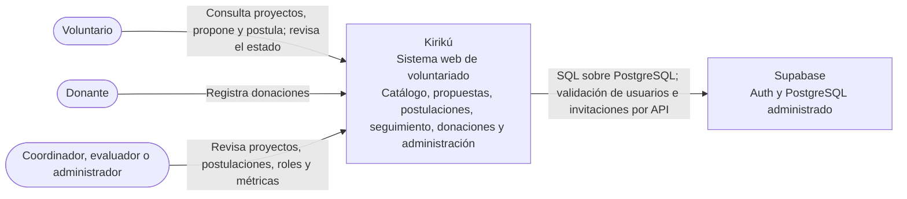
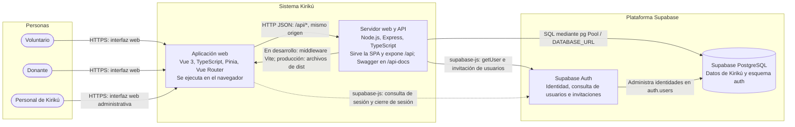
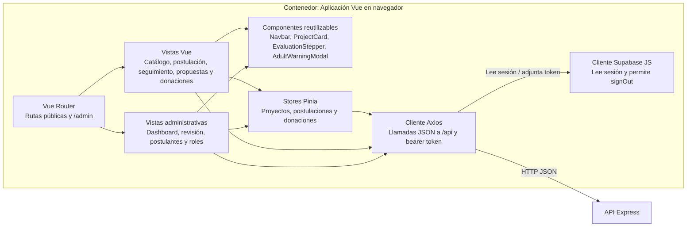

# Arquitectura C4 de Kirikú

Diagramas elaborados por inspección del código y la configuración del repositorio. Representan el comportamiento implementado actualmente, no una arquitectura objetivo.

## Nivel 1: contexto del sistema



## Nivel 2: contenedores



**Despliegue observado:** un proceso Express (`server.ts`) sirve tanto la interfaz como la API. En desarrollo integra Vite en modo middleware; en producción sirve `dist`. No se encontró un servicio separado de frontend o backend en la configuración del repositorio.

## Nivel 3: componentes del contenedor web



## Nivel 3: componentes del contenedor servidor

```mermaid
flowchart LR
    subgraph backend["Contenedor: Servidor Node.js / Express"]
        bootstrap["Arranque y entrega web\nserver.ts: Express, estáticos, Vite en dev"]
        router["Router REST /api\nOrganizaciones y proyectos; postulaciones y evaluación; donaciones; métricas; roles; imágenes"]
        login["Ruta de login\n/auth/login y /auth/demo-users"]
        middleware["Autenticación y autorización\nauthenticate + requirePermission"]
        handlers["Controladores de dominio\nValidación, reglas y orquestación de operaciones"]
        data["Acceso a datos\npg Pool + helper query()"]
        sbclient["Cliente Supabase JS\nValidación remota de usuario"]
        sbadmin["Cliente Supabase Admin opcional\nInvitaciones por correo"]
        docs["Documentación API\nSwagger UI y OpenAPI"]
    end

    pg[("PostgreSQL\norganizaciones, proyectos, postulantes, postulaciones, evaluaciones_etapas, donaciones, imagenes, usuarios, roles, permissions, role_permissions, user_roles, auth.users")]
    auth["Supabase Auth API"]

    bootstrap --> router
    bootstrap --> docs
    router --> login
    router --> middleware
    login --> handlers
    middleware --> sbclient
    middleware --> data
    middleware --> handlers
    handlers --> data
    handlers --> sbadmin
    data -->|SQL| pg
    sbclient -->|getUser(token)| auth
    sbadmin -->|inviteUserByEmail| auth
    auth --> pg
```

## Componentes y responsabilidades

| Área | Componentes principales | Responsabilidad |
|---|---|---|
| Interfaz pública | `ProjectsCatalogView`, `ApplyView`, `ApplicationStatusView`, `ProposeProjectView`, `DonationsView` | Catálogo y propuesta de proyectos, postulación, seguimiento y registro de donaciones. |
| Interfaz administrativa | Dashboard, revisión de proyectos, banco de postulantes y gestión de roles | Operación interna, evaluación y consulta de métricas. |
| Estado y transporte | Stores Pinia y `src/api/client.ts` | Estado reactivo del cliente y llamadas JSON al backend; el interceptor adjunta el token disponible. |
| API | `src/server/api.ts` | Rutas REST, validaciones de negocio y operaciones de dominio. |
| Autorización | `src/server/authorization.ts`, `src/server/permissions.ts` | Obtiene la identidad, carga permisos desde PostgreSQL y protege rutas administrativas. |
| Persistencia | `src/server/supabase.ts` | Pool PostgreSQL (`pg`) para las consultas SQL y clientes `supabase-js`. |
| Identidad | Supabase Auth | Validación de usuario e invitaciones administrativas cuando el cliente Admin está configurado. |
| Base de datos | Supabase PostgreSQL | Datos de negocio y tablas RBAC. La migración incluida crea `roles`, `permissions`, `role_permissions` y `user_roles`; las demás tablas se referencian en consultas y documentación. |

## Notas de inspección

- El inicio de sesión actual de la interfaz llama a `/api/auth/login`. Esa ruta compara correo y contraseña contra `public.usuarios` y devuelve el ID del usuario como token; el middleware después intenta validarlo con Supabase y tiene una ruta de respaldo que busca ese valor en `auth.users`. Por tanto, el flujo implementado no es un inicio de sesión estándar de Supabase Auth, aunque el frontend también inicializa el SDK de Supabase para leer/cerrar sesiones.
- `authenticate` reconoce además los valores fijos `dev-admin-token` y `admin-test-token` con permisos administrativos completos. El código los marca como soporte de desarrollo/pruebas; deben considerarse al desplegar.
- La ruta de alta administrativa intenta invitar al usuario mediante Supabase Auth Admin. Si no está configurado o falla, el código contiene un fallback que escribe directamente en `auth.users`.
- Los medios se manejan mediante la tabla `imagenes` (URL o contenido base64); no se encontró uso de Supabase Storage en el código inspeccionado.
- `@google/genai` aparece como dependencia, pero no se encontró importación o uso en `src`; por eso no figura como componente en los diagramas.
- Se documentan los niveles C1, C2 y C3. No se incluye C4 de código/clases porque duplicaría detalles de implementación que no ayudan a explicar los límites y responsabilidades del sistema.
